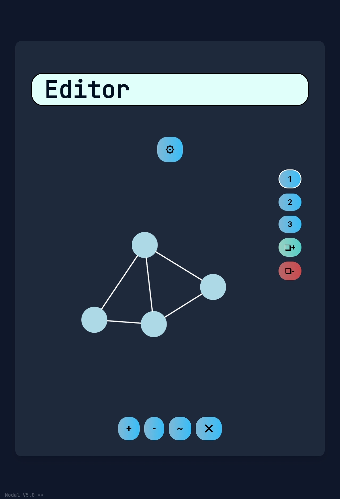

# ann

ann, a tool to make, train, infer, and inspect artificial neural networks.
ann is for learners, hobbyists, and professionals.

Visit [ann](https://nodal-e30094.gitlab.io)

Documentation for this project is in
`Files/Ann/documentation.txt`